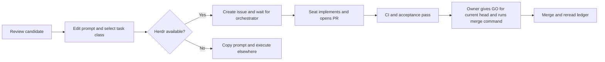

# Rules review and promotion PRD

2026-11-16 · @Ancienttwo

## Conclusion

Add an independent `rules` module. It gives rh-app a read model for lessons and rules. A user can edit a prompt and submit a promotion task to the existing orchestrator. The module composes existing capabilities: `rh run maintenance-triage` parses the ledger, the orchestrator dispatches work, and the console write channel handles writes. It has no parser, task store or dispatcher of its own. Use Herdr worker seats; do not add a headless host.

The owner decided on 2026-11-16 that `rules` is a PRD-level module, that users submit promotion prompts from the page, and that the frontend provides agent conversation. The ten decisions below are approved.

At `df01a1b`, the migrated ledger had 16 lessons and 16 themes. All used `Enforced by: judgment`. Ten themes had Seen ≥ 3 and no `Promoted`. Triage reported those ten themes, zero field errors and zero evidence errors. Phases 1 and 2 have parent [#2879](https://github.com/aimpact-inc/repo-harness/issues/2879) and children #2880–#2890. Phases 3 and 4 have no issues yet.

### Outside review of v1 (seven points) and the v2 changes

| # | Review point | Check result (at df01a1b) | v2 change |
|---|---|---|---|
| 1 | `rules` should compose existing capabilities and not bring its own parser, task store or dispatcher. | Agreed. The LedgerEnforcement that v1 named is not on main yet (#2815 not merged); the only ledger parser is `scripts/maintenance-triage.sh`. | The read model calls triage; see "Module and read model". |
| 2 | The "to be enforced" condition conflicts with the spec, and the baseline changed. | Holds. A missing `Enforced by` is a field error that triage reports; all 16 entries are judgment now. | Candidates are classified by theme, using judgment and Promoted. |
| 3 | "Dispatch directly when there is no orchestrator seat" is not an existing capability. | Holds. `rh board dispatch` needs a plan comment on the parent, the issue in merge_order, an orchestrator claim, and it handles every item of the plan at once. | The first version only submits to the existing orchestrator; the page shows "waiting for orchestrator". |
| 4 | Seats and `route:` classes are mixed. | Holds. The `route:` label values are 5 task classes, not 5 seats. | The user picks a task class; the page shows the expected seat; the task page shows the actual seat. |
| 5 | "Enforced" cannot equal task done; four states are not enough. | Holds. A merged PR does not show that the theme changed to a file path in the ledger. | States split into a governance result and a task progress. |
| 6 | Cross-system recovery is not defined; candidates have no stable id. | Holds. The write channel has `reconcile_required`, but it only marks and does not recover. | Adds candidate ids, prompt binding and a recovery table. |
| 7 | Messaging the executing seat must first verify the task binding. | Holds. `rh fleet message send` needs admission, claim and session, and the server checks each one. | The check moves to phase 1; the conversation stays in phase 3. |

The owner confirmed points 3 and 4 on 2026-11-16. They change the earlier choice of agent and direct dispatch.

## Scope and non-goals

This PRD covers the `rules` module and its rh-app pages. It does not redefine the ledger fields, their validation or the rule result chain.

| Document | Scope |
|---|---|
| This PRD | `rules` read model, promotion tasks, cross-repository candidate index and rh-app rules pages |
| [Rule runtime PRD](20261116-0323-ledger-enforcement-test-budget.prd.md) | Ledger fields and validation (M1), `TestBudget` result chain (M2), text cleanup (M3) |
| [Console PRD](20261026-2310-operator-console-uiux.prd.md) | Page shell, write channel (token, idempotency, audit) and design system |

This PRD owns cross-repository rule productization. Each repository keeps its own `tasks/lessons.md`; there is no global ledger and `Seen` counts are not added across repositories. Promotion requires a person. The console does not merge a PR or give the repository owner’s GO. It does not reopen a headless coding host or write built-in rules into `~/.claude/` or `~/.codex/`.

## User flow



| Step | Actor | Action | Record |
|---|---|---|---|
| Review candidate | User | Open the detail and read the original lesson and each correction source | None |
| Edit prompt and select class | User | Edit the prefilled prompt; optionally consult the advisor | Final prompt and its sha256 |
| Create issue and wait | Console server | Create a child under the rules parent and add a `route:` label; do not dispatch | Issue and audit record |
| Plan and dispatch | Orchestrator | Add the child to the plan's `merge_order` and run `rh board dispatch` | Plan comment and claim |
| Implement and open PR | Worker seat | Make the check, update the ledger entry and open a PR | PR and two evidence results |
| CI and acceptance | CI and acceptor | Run checks and review evidence | Check results |
| Give GO | Owner | Give GO for the current head SHA and run the merge command | GO record |
| After merge | Module | Reread the ledger; change governance only if the theme changed | None |
| No Herdr | User | Copy the prompt and run it in their own harness | No issue |

## Module and read model

The module reads existing authorities and computes candidates. It stores no ledger and does not parse it. Its only file is a rebuildable cross-repository index.

| Content | Authority | Module action |
|---|---|---|
| Lessons and theme summaries | Each repository's `tasks/lessons.md`, parsed by `rh run maintenance-triage --json` | Call triage. Extend its JSON to include all themes; today it emits only judgment themes with Seen ≥ 3. |
| Rule definitions | Product rule registry (M2) | List ids, parameters and repair hints. |
| Rule switches | Each repository's `.ai/harness/policy.json` `rules` section | Show enabled, off, missing configuration or invalid configuration. |
| Check results | Evidence chain (M2) | Read the latest result, original over-limit values and exception. |
| Promotion task progress | GitHub issues and PRs | Link by candidate id; do not store tasks. |
| Cross-repository candidates | Derived `~/.repo-harness/rules/index.json` | Rebuild from registered repositories' ledgers. |

Compute candidates by theme. Use triage's normalized `Mistake pattern` key. Take Seen and `Enforced by` from the latest entry for the theme and the last recorded `Promoted` from any entry.

| Theme state | Condition | Page action |
|---|---|---|
| Ledger needs repair | Triage reports field or evidence errors | Show the errors and repair hints. A field error prevents all theme computation and candidates. |
| Machine enforcement can be evaluated | `Enforced by: judgment`, Seen ≥ 2 | Start a check that fails on recurrence and replace `judgment` with a file path. |
| Root rule needed | `Enforced by: judgment`, Seen ≥ 3, no valid `Promoted` | Add the rule to root `AGENTS.md` and `CLAUDE.md` and record `Promoted`. |
| Structurally enforced | `Enforced by` is a file path | Not a candidate; show the enforcing file. |
| Built-in rule candidate (phase 4) | Same theme key has corrections in at least two registered repositories and at least one has structural enforcement | Start a product PR in repo-harness. |

The two judgment actions can overlap. Show one row with both actions and allow only one active action at a time. Default to machine enforcement. At `df01a1b`, all ten candidates met both conditions; Seen values were 1, 3, 5, 7 and 11. An evidence-only error is a warning and does not hide otherwise valid themes or candidates.

#2815's `LedgerEnforcement` defines valid `Promoted` format; a reviewer judges the root rule text. Before #2815 merges, treat nonempty `Promoted` as promoted. Its decision table fails a judgment theme with Seen ≥ 3 and no `Promoted`.

The read entrypoint is `rh rules status --json`. A console GET route is a thin wrapper; a background collector caches it.

```json
{ "kind": "repo-harness.rules.status", "protocol": 1, "repository_id": "…",
  "ledger": { "path": "tasks/lessons.md", "head": "…", "blob": "…", "dirty": false,
              "valid": true, "entries": 16, "field_errors": [], "evidence_errors": [] },
  "themes": [
    { "key": "one-authority-per-value", "seen": 7,
      "enforced_by": "judgment", "promoted": null,
      "governance": "judgment_unpromoted",
      "actions": [
        { "kind": "enforce", "candidate_id": "…", "task": null },
        { "kind": "promote_root", "candidate_id": "…", "task": null } ] } ] }
```

Cross-repository matching first uses exact theme keys. Triage normalizes keys to lowercase and replaces non-alphanumeric characters with hyphens. Duplicates copied from one template are not independent evidence. Show their sources for human judgment.

## Promotion task

One promotion has one candidate, one prompt package, one task class and one issue.

### Candidate id and snapshot

Derive a stable candidate id from repository id, theme key and action: `enforce` or `promote_root`. It stays the same across requests and browsers. At submission, record the ledger's HEAD git blob and the theme's Seen, `Enforced by` and `Promoted`. Reread the ledger before execution. Refuse a changed blob or a dirty ledger and ask the user to refresh.

The final prompt line is a marker with candidate id and task class. The user cannot edit it. The issue body is the prompt. Find issues for deduplication and recovery by this marker on GitHub, not by local console state.

### Prompt package

The module prefills the package; the user can edit its content. Record the final text's sha256 and bind it with repository id, theme key, snapshot, action and task class in `binding_sha256`. The write channel refuses the same `request_id` with different content as `request_mismatch`.

| Field | Content | Source |
|---|---|---|
| Goal | Make recurrence fail for machine enforcement; add the root rule for root promotion | Module, by action |
| Lesson | `Mistake pattern`, `Prevention rule`, `Why`, all correction sources | Ledger |
| Enforcement ladder | Architecture or data structure, types, a check with a repair message, tests; use `judgment` only when none works | Lessons Retro specification |
| Evidence | New check fails on the real faulty commit and passes after the fix; put both results in the PR | Lessons Retro specification |
| Ledger change | Machine enforcement replaces `Enforced by` with a file path; root promotion adds `Promoted`; neither changes old Seen values | Lessons Retro specification |
| Boundary | No unrelated files or compatibility path; stop and ask for out-of-scope changes | Issue-flow child template |
| User addition | Free text | User |

### Task class

The user selects one of `important_deep`, `important_fast`, `simple_deep`, `simple_fast` or `frontend`. The issue gets `route:<class>`. These classes are not the five worker seats: `worker`, `worker-deep`, `worker-important`, `worker-important-fast` and `worker-light`. `seats.routing` in `~/.repo-harness/config.json` maps each class to candidate seats; dispatch selects by quota.

Show the expected seat, runtime and model using the same routing algorithm as `rh quota`. This is an estimate: quota can change before dispatch. The task page shows the actual seat.

### Submit

`rh rules promote` performs the server operation; HTTP is a thin wrapper. The first version creates an issue for the existing orchestrator. The console never calls `rh board dispatch`.

| Repository state | Result | Page |
|---|---|---|
| Rules parent has a plan comment and orchestrator claim | Create and label the child; orchestrator adds it to the plan and dispatches | Waiting for orchestrator |
| Herdr exists but plan or orchestrator claim is missing | Create the child; no seat takes it until the orchestrator takes the parent | Waiting for orchestrator, with missing item |
| No Herdr | Create no issue | Copyable prompt |

Dispatch requires a parent plan and orchestrator claim, processes only issues in `merge_order`, and processes the whole plan. A new child is not yet in that order. The prompt is copyable in every state. Each repository has a rules parent issue; create one first if absent.

### Conversation

| Recipient | When | Existing capability | Addition |
|---|---|---|---|
| Advisor seat | Before submission | `OfficeAdvisorDialog` uses `rh board advisor send` and transcript | Phase 2 opens it from candidate detail with candidate context. |
| Worker seat | After dispatch | Console reads task inbox; `rh fleet message send` requires admission, claim and session. Server checks admission sha256, claim identity and worktree; it refuses with `task_revision_mismatch`, `claim_mismatch` or `recipient_unavailable`. | Phase 3 permits follow-up for rules tasks only, if phase 1 binding verification passes. |

Phase 1 must document whether the console can obtain valid admission, claim and session from an issue number and pass task inbox validation. If it cannot, omit the write and use issue comments for follow-up. Use the design system `Conversation` component and console PRD G3 scope: message text, tool category, repository-relative paths and execution status.

## Write and permission boundary

| Write | Destination | Limit |
|---|---|---|
| Start promotion | GitHub child issue under rules parent, labels and child link | Refuse an existing open issue for the candidate id regardless of `request_id`. Do not dispatch. |
| Send worker follow-up (phase 3) | That task's inbox | Only tasks started by this module; refuse a failed binding check. |
| Rebuild cross-repository index | `~/.repo-harness/rules/index.json` | Derived data; it can be rebuilt. |

The console does not write `tasks/lessons.md`, `policy.json`, rule source, root `AGENTS.md` or `CLAUDE.md`; the worker changes them in a PR. It does not merge PRs or give GO. The page displays a command for the owner to copy and run. Merge uses `rh publication merge` or the owner. The console does not write `~/.claude/` or `~/.codex/`.

All three operations use the existing console write channel: validate Origin and write token; execute each `request_id` once; append to `~/.repo-harness/operator/audit.jsonl` before execution; keep GitHub credentials on the server; provide a CLI first and forward HTTP to it.

### Cross-system recovery

The write channel marks uncertain outcomes `reconcile_required` and does not replay them. `rh rules promote --reconcile` checks GitHub; the page wraps this command.

| Situation | Recovery |
|---|---|
| Issue created but response lost | Find the marker on GitHub and link the candidate to the issue; permit resubmission only if absent. |
| Issue created but child link or labels incomplete | Add missing steps during reconcile; check before each write so repetition has the same result. |
| Claim may have started | Read and show GitHub claim records; do not create or revoke a claim. |
| Two `request_id` values for one candidate | Lock the candidate id as the write target; refuse the later request and return the existing issue. |
| Ledger changed at submission | Refuse the snapshot mismatch; user refreshes and reviews again. |

### Changes to existing agreements

| Existing agreement | Source | Change |
|---|---|---|
| Console write operation list | Console PRD write table | Add the three writes above. |
| Coding sessions do not use the console | Console PRD | Rules tasks can start in the console and show worker conversation; other tasks stay unchanged. |
| Console conversation only with advisor | Earlier owner decision | Allow follow-up to worker seats for rules tasks. |
| Cross-repository rules have no separate PRD | Rules-runtime PRD | Move the scope to this PRD. |

## Pages

Use the console design system and visual language.

| Page | Content | Main actions |
|---|---|---|
| Rules | Candidates, enabled rules and ledger sections | Filter, open detail |
| Candidate detail drawer | Original lesson, correction links, enforcement ladder, prefilled prompt, task class and expected seat | Edit, select class, submit, copy prompt, ask advisor |
| Rules task | Issue, claim, actual seat, PR, CI, acceptance and GO command; worker conversation in phase 3 | Reconcile, copy GO command; send follow-up in phase 3 |
| All repositories | Cross-repository candidates, their repositories and structural enforcement | Open candidates, start built-in rule task |

### State terms

Governance comes only from the ledger; task progress comes only from GitHub. Neither implies the other.

| Governance result | Condition |
|---|---|
| Ledger needs repair | Triage reports an error |
| Judgment · not in root rules | `Enforced by: judgment`, no `Promoted` |
| Judgment · in root rules | `Enforced by: judgment`, with `Promoted` |
| Structurally enforced | `Enforced by` is a file path |

For structural enforcement, show enabled state, checked version, latest check SHA and time from the M2 result chain in phase 3. Before then show “not connected”.

| Task progress | Condition |
|---|---|
| Ready to start | Candidate has no open issue |
| Waiting for orchestrator | Issue exists, no claim |
| Seat working · PR #n | Claimed; PR is not ready for GO |
| Waiting for GO | CI and acceptance pass; owner GO for current head SHA is pending |
| Merged | PR merged; ledger determines governance result |
| Closed · incomplete | Issue closed without a merged PR |
| PR rejected | PR closed without merge or acceptance failed |
| Failed | Claim ended without a PR or seat reported failure |
| Unknown | GitHub cannot be read or submission needs reconcile |

If the PR merges without a ledger change, the candidate returns to ready to start and shows the previous PR.

### Page states

| Situation | Display |
|---|---|
| Ledger format check fails | Reason and error lines; no candidates |
| No candidates | One sentence and a link to the ledger section |
| No Herdr | Candidates remain visible; replace submit with copy prompt |
| Herdr but no plan or orchestrator | Permit submission; show waiting and what is missing |
| Submission fails or is uncertain | Show the stopped step and whether the issue exists; offer reconcile; do not retry automatically |

### Entry and design

Place Rules in the Observability navigation group. Include ready-to-start and waiting-for-GO counts in the home page's items awaiting action. `ux-feature-guard` requires an owner-confirmed `docs/prds/DESIGN-<slug>.md` before UI code. Draft that brief separately after this PRD.

## Dependencies and phases

| Phase | Delivery | Prerequisite |
|---|---|---|
| 1 | Read-only Rules page with candidates and ledger, `rh rules status --json`, and a task-binding investigation without UI; reuse triage parsing and theme aggregation | Triage JSON emits all themes (a rules-runtime change) |
| 2 | Candidate snapshot, prompt editing, `rh rules promote`, reconcile and recovery, task progress, advisor from candidate detail | Confirmed design brief and approval of promotion write |
| 3 | Worker follow-up, enabled rules section and per-rule run results | Phase 1 binding check passes, rules-runtime M2 and owner decision on worker conversation |
| 4 | Cross-repository candidates and built-in rule product PR flow | Phases 1–3 have run on at least two registered repositories |

The ledger migration was on main at the draft baseline, with all 16 entries carrying `Enforced by` and no triage field or evidence errors. Phase 1 needs the all-themes triage JSON extension, not a second parser.

Register `rules` as a component under the verification capability through `repo-harness-architecture`. Ledger format and `Enforced by` belong to rules-runtime M1; the registry and result chain belong to M2. Seat routing and quota remain existing capabilities that this module reads.

## Acceptance

Each row must be checkable by a command or a test.

| # | Check | Phase |
|---|---|---|
| 1 | On the repo-harness repository, the theme count and candidate count on the Rules page equal `rh rules status --json`; its judgment themes equal `rh run maintenance-triage --json`. | 1 |
| 2 | When the ledger format check fails, the page shows the failure reason, the candidate list is empty, and the CLI exits non-zero. | 1 |
| 3 | The task-binding check has a written conclusion: can the console get admission, claim and session from an issue number and pass the task inbox validation. | 1 |
| 4 | After a promotion starts, the sha256 of the issue body equals the sha256 of the prompt that the user confirmed. | 2 |
| 5 | When an open issue already exists for the same candidate id, a new start with another request_id is refused and creates no second issue. | 2 |
| 6 | The same request_id submitted twice creates one issue, and the audit log has one execution. | 2 |
| 7 | The process is interrupted after the issue is created and before the links are added; after reconcile runs, the links and labels are complete and there is still one issue. | 2 |
| 8 | When the ledger file revision at submit differs from the candidate snapshot, the request is refused and no issue is created. | 2 |
| 9 | In every repository state, the console process never calls `rh board dispatch`. A repository without Herdr only gets a copyable prompt and no issue. | 2 |
| 10 | When the PR merges but the theme does not change in the ledger, the task progress is "merged", the governance result does not change, and the candidate stays. | 2 |
| 11 | When the theme's `Enforced by` becomes a file path in the ledger, the governance result is "structurally enforced" and the candidate disappears. | 2 |
| 12 | The console process makes no write to `tasks/lessons.md`, `policy.json`, rule source code or root files, and no merge call on a PR. | 2 |
| 13 | A follow-up message can go only to a task that this module started; requests for other tasks and requests that fail the binding check are refused. | 3 |
| 14 | Rebuilding the cross-repository index twice from the same input gives two byte-identical files. | 4 |
| 15 | The data that the browser receives has no absolute path, no raw terminal text and no environment variable. | 1 to 4 |

Rows 12 and 15 are negative checks; rerun them in every phase.

## Decisions

The owner accepted all ten recommendations on 2026-11-16 at 15:21 Taipei time.

1. Use Herdr worker seats (claude, codex, pi). The headless docs host was closed in #1149 after isolation check D1 failed; its allowlist is empty.
2. Put the prompt in the issue body and use the orchestrator to dispatch it. The issue preserves the prompt and claim record.
3. Select a task class and show an estimated seat. Quota-based routing chooses the actual seat; direct seat pinning is not supported.
4. Without an orchestrator, create the issue, show waiting for orchestrator and offer prompt copy. Do not add direct dispatch.
5. Permit worker-seat follow-up only for rules tasks in phase 3, subject to the binding check.
6. Show worker conversation at G3 scope: message text, tool category, relative paths and status.
7. Offer machine enforcement at Seen ≥ 2 and root promotion at Seen ≥ 3 without `Promoted`. Default to machine enforcement.
8. Move cross-repository rules scope from the rules-runtime PRD to this PRD; leave a link there.
9. Put the Rules page in Observability.
10. Register `rules` as a component of the verification capability.

## Sources

- [Rules runtime and ratchet PRD draft](https://claude.ai/artifact/43uZMVZG2txkBFWqcQGDZG): M1, M2, M3 and the original cross-repository scope.
- [Console UI/UX PRD](https://claude.ai/artifact/6nK8dssBnBGMEB74CnvZHa): write channel, write operation list and G3 display scope.
- Project document `operator-console/设计系统.md`: `Conversation`, `CommandCopy` and other components.
- [Rules review draft, revision 22](https://claude.ai/artifact/Dhpu35HJfapULWXqDcfkDa): source of this PRD, read by the advisor on 2026-11-17.

The v1 source review used `cc7cf86`; v2 checked `df01a1b`.

| Repository source | Evidence |
|---|---|
| `src/core/operator/docs-host-runtimes.ts` | Docs host closed; `DOCS_HOST_RUNTIME_IDS` empty (#1149) |
| `OfficeAdvisorDialog`, `SeatsPage`, `SettingsPage` under `src/operator-web/` | Advisor conversation and seat settings |
| `src/cli/commands/board.ts`, `seats.ts` | Board dispatch, advisor send and transcript |
| `assets/reference-configs/agentic-development-flow.md` | Lessons Retro ladder, Seen thresholds, `judgment`, `Promoted` and owner GO |
| `tasks/lessons.md` | Ledger baseline |
| `assets/skills/repo-harness-issue-flow/` | Parent and child templates, labels and dispatch |
| `scripts/maintenance-triage.sh` (v2) | Ledger parser, theme key and Seen/Promoted selection, field and evidence errors |
| `src/core/board/dispatch.ts`, `src/effects/board/dispatch.ts` (v2) | Plan, `merge_order` and orchestrator claim prerequisites; whole-plan dispatch |
| `src/core/board/seats-settings.ts`, `seat-routing.ts` (v2) | Five seats, five classes and candidate seat routing |
| `src/effects/operator/write-run.ts` (v2) | Request binding, `reconcile_required`, `request_mismatch` and target lock |
| `src/effects/fleet/task-inbox.ts` (v2) | Three checks for worker messages |

At `df01a1b`, the ledger count was checked against `scripts/maintenance-triage.sh --json`: 16 entries, 16 themes, all judgment, ten with Seen ≥ 3 and zero `Promoted`. The v1 claim that `Enforced by` was zero described `cc7cf86` before migration.

`rh rules status`, `rh rules promote` and the index are proposals and did not exist at the draft baseline. The task inbox code was read, but console access to all three binding inputs was not verified; phase 1 must answer it. Actual runtime and model availability in claim records was not verified, so the task page promises only the actual seat. The outside review used `98a4ff9ea`; the difference from `df01a1b` was not checked commit by commit.
